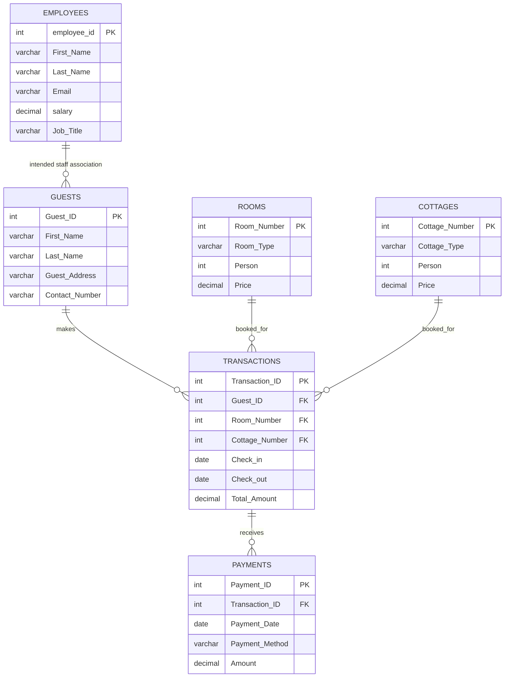

# ResortManagementSystem
# Resort Management System — SQL Project

## 1. Project Overview

The **Resort Management System** is a database project developed using **MySQL** to organize resort operations. It stores information about employees, guests, rooms, cottages, reservations/transactions, and payments.

The project demonstrates how a relational database can store connected information and answer common business questions using SQL queries.

## 2. Objectives

- Store and manage employee information.
- Maintain room and cottage types, capacities, and prices.
- Keep guest contact details.
- Record booking transactions, check-in/check-out dates, and total amounts.
- Record payments, including payment dates, methods, and amounts.
- Generate reports using filtering, aggregation, joins, subqueries, and sorting.

## 3. Technology Used

- **Database:** MySQL
- **Query language:** SQL
- **Recommended client:** MySQL Workbench

## 4. Database Schema

Database name: `ResortManagementSystem`

| Table | Purpose | Important columns |
|---|---|---|
| `Employees` | Stores resort staff details | `employee_id`, `First_Name`, `Last_Name`, `Email`, `salary`, `Job_Title` |
| `Guests` | Stores guest details | `Guest_ID`, `First_Name`, `Last_Name`, `Guest_Address`, `Contact_Number` |
| `Rooms` | Stores room types, capacities, and prices | `Room_Number`, `Room_Type`, `Person`, `Price` |
| `Cottages` | Stores cottage types, capacities, and prices | `Cottage_Number`, `Cottage_Type`, `Person`, `Price` |
| `Transactions` | Stores guest bookings and stay details | `Transaction_ID`, `Guest_ID`, `Room_Number`, `Cottage_Number`, `Check_in`, `Check_out`, `Total_Amount` |
| `Payments` | Stores payments linked to transactions | `Payment_ID`, `Transaction_ID`, `Payment_Date`, `Payment_Method`, `Amount` |

## 5. ER Diagram

The following diagram describes the intended relationships represented by the foreign keys in the SQL script.



**Relationship explanation**

- **Guests → Transactions:** one guest can have multiple bookings; each transaction references one guest.
- **Rooms → Transactions:** a room can appear in multiple transactions over time; each transaction can reference a room.
- **Cottages → Transactions:** a cottage can appear in multiple transactions over time; each transaction can reference a cottage.
- **Transactions → Payments:** one transaction can have multiple payment records, allowing split payments.
- **Employees → Guests:** the script contains a foreign-key reference from `Guests` to `Employees`, but the `Employee_ID` column is not declared in the supplied `Guests` table definition. This relationship must be fixed before the script can run as written.

> **Important:** The ER diagram shows the intended employee–guest association. To implement it, add an `Employee_ID` column to `Guests` before creating its foreign key, or remove that foreign key if the association is not required. Also, a transaction currently allows both `Room_Number` and `Cottage_Number` to be `NULL` or both to be populated; add a constraint if each booking must select exactly one accommodation type.

## 6. SQL Concepts Demonstrated

The project includes examples of:

- `CREATE DATABASE` and `USE`
- `CREATE TABLE`, primary keys, foreign keys, `AUTO_INCREMENT`, `NOT NULL`, `UNIQUE`, and `CHECK`
- `INSERT INTO` for sample data
- `SELECT`, `WHERE`, `ORDER BY`, and `DISTINCT`
- Aggregate functions: `COUNT()`, `SUM()`, `AVG()`, `MIN()`, and `MAX()`
- `GROUP BY` and `HAVING`
- Subqueries, including second-highest salary and comparisons with average prices/salaries
- `JOIN` operations, including `LEFT JOIN`
- Business reports for bookings, guest spending, room types, and payment methods

## 7. How to Run the Project

1. Install and open **MySQL Workbench** (or another MySQL client).
2. Open the supplied `ResortManagementSystemproj.sql` file.
3. Review the `Guests` table definition and fix the missing `Employee_ID` column/foreign-key issue noted above.
4. Check that the sample payment `Transaction_ID` values match the IDs actually generated by the `Transactions` inserts. The payment data uses IDs `141`–`155`, while the transaction inserts omit explicit IDs; these may not match in a fresh database. Use the actual transaction IDs or insert explicit IDs consistently.
5. Execute the script in order, from database creation through table creation and data insertion.
6. Run the reporting queries and inspect the results.

For a clean test, run the project in a new development database. The script begins with `CREATE DATABASE`; it does not reset or drop an existing database.

## 8. Example Queries

### Count all employees

```sql
SELECT COUNT(*) AS Total_Employees
FROM Employees;
```

### Find employees earning more than the average salary

```sql
SELECT employee_id, First_Name, Last_Name, salary
FROM Employees
WHERE salary > (
    SELECT AVG(salary)
    FROM Employees
);
```

### Count rooms by room type

```sql
SELECT Room_Type, COUNT(*) AS Total_Rooms
FROM Rooms
GROUP BY Room_Type;
```

### Find guests and their booking counts

```sql
SELECT g.Guest_ID, g.First_Name, g.Last_Name,
       COUNT(t.Transaction_ID) AS Booking_Count
FROM Guests AS g
LEFT JOIN Transactions AS t
    ON g.Guest_ID = t.Guest_ID
GROUP BY g.Guest_ID, g.First_Name, g.Last_Name;
```

### Calculate the total amount recorded in payments

```sql
SELECT SUM(Amount) AS Total_Payments_Recorded
FROM Payments;
```

These examples are drawn from the types of queries included in the supplied project. The payment total is the sum of payment records; it should not automatically be interpreted as total revenue or total billed until transaction and payment records have been reconciled.

## 9. Data Included

The script contains sample data for:

- Employees
- Guests
- Rooms
- Cottages
- Booking transactions
- Payments using methods such as UPI, cash, debit card, and credit card

The sample booking dates are in 2026. The records are demonstration data, not a live resort system.

## 10. Known Issues and Suggested Improvements

Before presenting or using this project as a fully executable database, review these items:

1. **Guests foreign key:** `Guests` references `Employees(Employee_ID)`, but `Employee_ID` is missing from the `Guests` column list. Add the column or remove the relationship.
2. **Transaction IDs in payments:** payment rows use transaction IDs `141`–`155`, but the transaction insert statements do not explicitly set those IDs. Confirm the actual generated IDs and align the payment records.
3. **Booking query join:** the query for guests spending more than 10,000 joins `Guests` and `Transactions` without an `ON` condition. Add `ON g.Guest_ID = t.Guest_ID` to avoid an unintended Cartesian join.
4. **Booking-count grouping:** include all selected non-aggregated guest columns in `GROUP BY`, such as `g.Last_Name`, for clarity and compatibility with strict SQL modes.
5. **Accommodation selection:** add a `CHECK` constraint or application logic so a transaction selects a room or a cottage according to the intended business rule.
6. **Stay dates:** consider a constraint requiring `Check_out > Check_in`.
7. **Payment validation:** add rules or reporting queries to compare the sum of payments against each transaction's `Total_Amount`, identify underpayments, and detect overpayments.
8. **Availability:** the current schema does not enforce date-overlap checks for rooms or cottages. Add booking validation to prevent double-booking.
9. **Security and data quality:** consider validating contact numbers, restricting payment-method values, and using appropriate access permissions for production use.

## 11. Future Enhancements

- Add a booking availability check based on check-in and check-out dates.
- Add payment status such as pending, partially paid, and paid.
- Add employee assignment to bookings if needed.
- Create views for booking summaries and payment reports.
- Add stored procedures and triggers for selected business rules.
- Build a frontend application for staff and guest interactions.
- Add authentication, role-based permissions, and audit logging.

## 12. Conclusion

The Resort Management System is a MySQL practice project that models core resort data and demonstrates relational database design and SQL reporting. It provides a foundation for learning primary and foreign keys, aggregate functions, subqueries, joins, and business-oriented queries. Resolving the noted schema and sample-data issues will make the project more reliable to execute and demonstrate.

---

**Project type:** Database / SQL  
**Database:** MySQL  
**Main file:** `ResortManagementSystemproj.sql`
**Created By:** Maheshwari Thangella
